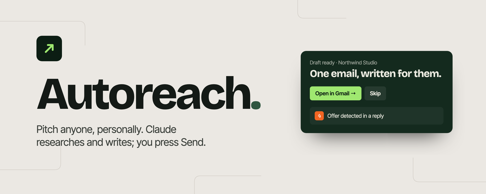
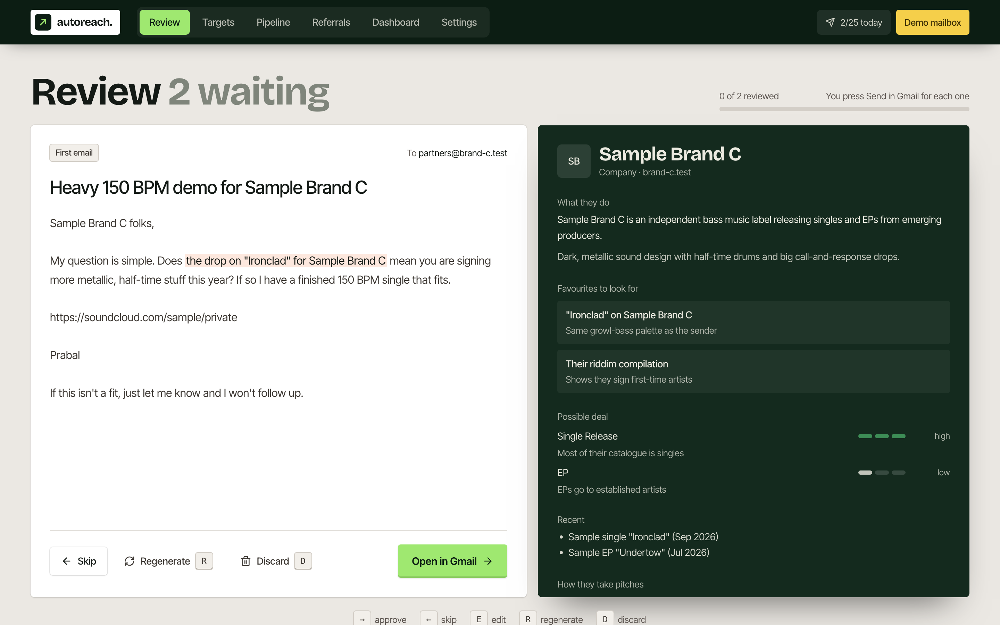
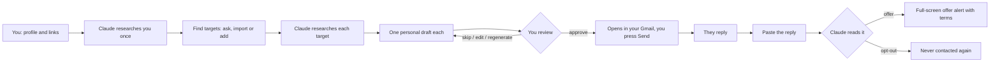
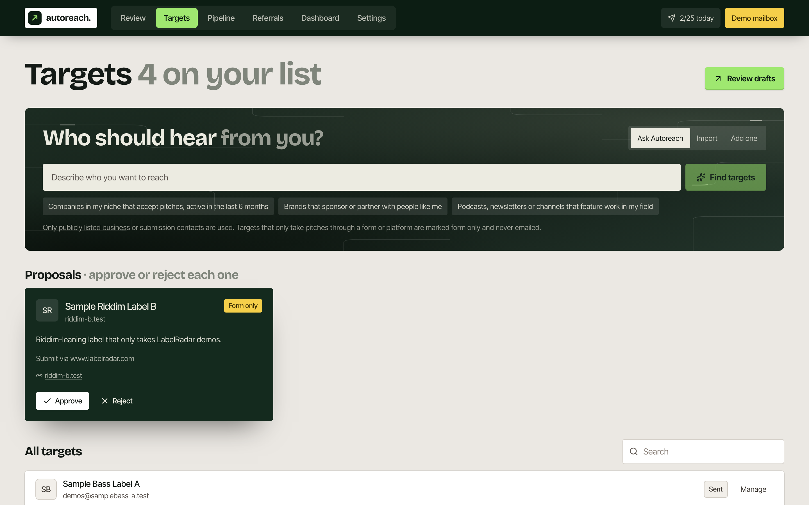
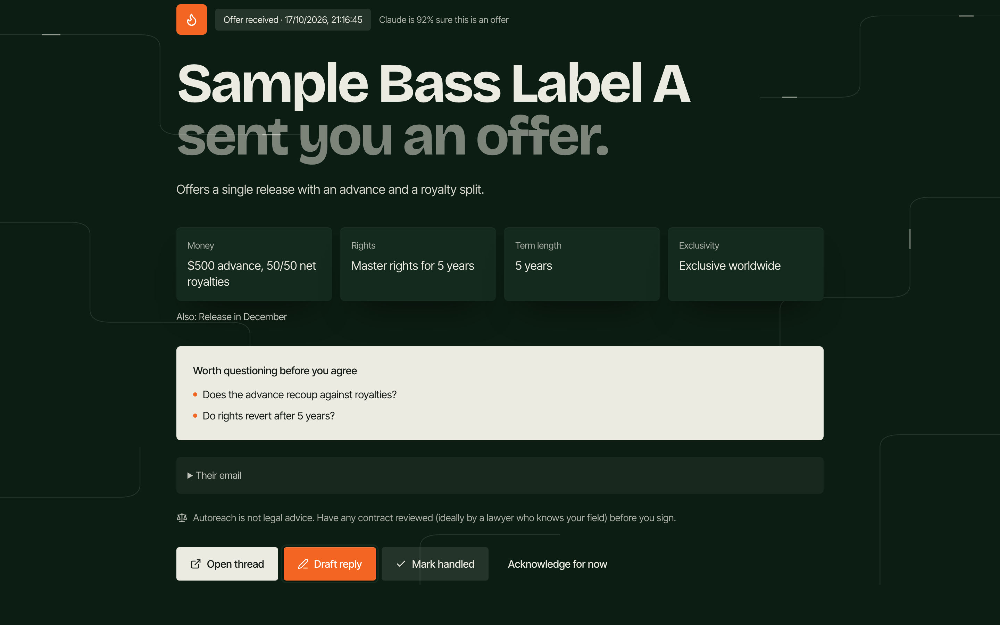
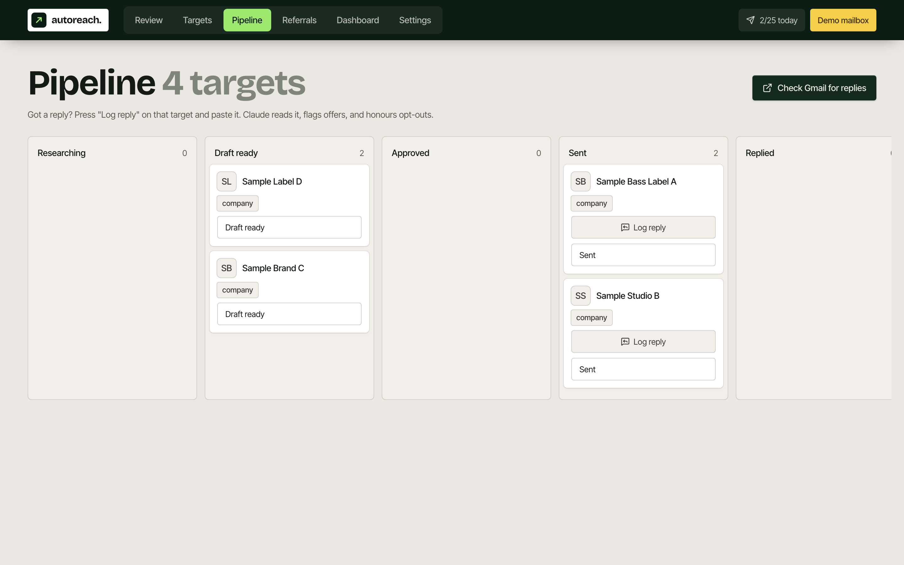
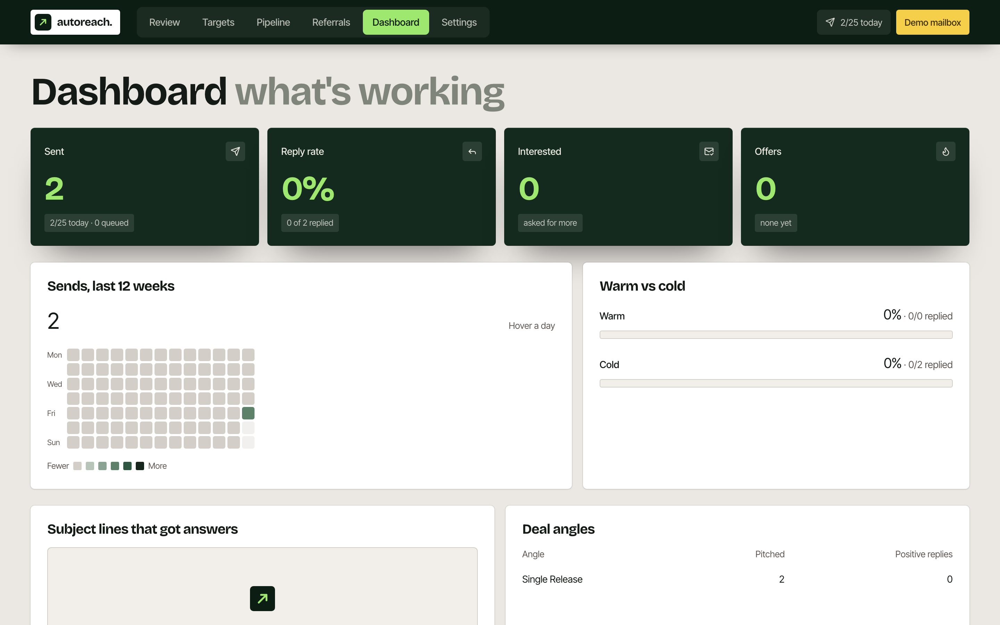

<div align="center">

<picture>
  <source media="(prefers-color-scheme: dark)" srcset="assets/banner-dark.png">
  
</picture>

### Personal outreach that runs on your own Claude Code.

Claude finds who to pitch, researches each one, and writes one email that could only have been sent to them.<br>
You review every draft like a flashcard, it opens in your Gmail, and you press Send.

<p>
  <a href="#install"></a>
  <a href="#how-it-works"></a>
</p>

<p>
  
  
  
  
  
</p>

<br>



</div>

## Why Autoreach

Cold pitches fail when they read like a mail merge. Autoreach makes every email specific, and keeps you in charge of every send.

- **Works for any field.** Musicians pitching labels, designers pitching studios, writers pitching editors, freelancers pitching clients, small businesses pitching partners.
- **Research before writing.** Claude reads your links once to learn who you are, then researches each target: what they do, recent work worth mentioning, likely deal types and red flags.
- **One email per person.** Under 150 words, one real reference to their work, one ask, one link. Drafts that look templated are rejected and rewritten.
- **You approve everything.** Keyboard flashcards: approve, skip, edit, regenerate, discard. There is no "approve all".
- **Nothing to set up for email.** Approved drafts open in Gmail's own compose window, already written. No passwords, no tokens, no inbox access.
- **Offers don't slip by.** Paste a reply and Claude pulls out the money, rights, term and exclusivity, plus the questions worth asking before you agree.
- **Your plan, your machine.** Every AI call goes through the `claude` CLI you already pay for. Data lives in `~/.autoreach` on your Mac.

## Install

In a terminal with Claude Code:

```bash
claude plugin marketplace add PrabalGamez/Autoreach
claude plugin install autoreach@autoreach
```

Restart Claude Code, then run:

```
/autoreach
```

Your browser opens straight away. The very first launch shows a setup page for about 30 seconds while it installs its parts into `~/.autoreach/app`, then switches to the app by itself. You need Node 20+ and a signed-in terminal `claude`. If `claude` says you are not logged in, run `claude auth login`; the desktop app's sign-in does not cover the terminal.

| Command | What it does |
| --- | --- |
| `/autoreach` | Starts the local app on `127.0.0.1:4747` and opens it |
| `/autoreach status` | Prints your pipeline, today's sends and any offers waiting |
| `/autoreach stop` | Shuts the local app down |

## How it works



1. **Connect.** Autoreach checks for Claude Code on your Mac and that you're signed in.
2. **Profile.** Your name or brand, one-line pitch, field, links and best work. Claude researches you once and shows what it found, including anything it couldn't confirm.
3. **Gmail.** Type your address. That's all.
4. **Targets.** Ask in plain words ("brands that sponsor people like me"), import a CSV, or add one by hand. Targets that only accept pitches through a form or platform are marked form-only and never emailed.
5. **Review and send.** Approve with <kbd>→</kbd>, skip with <kbd>←</kbd>, edit with <kbd>E</kbd>, regenerate with <kbd>R</kbd>, discard with <kbd>D</kbd>.
6. **Replies.** "Check Gmail for replies" opens one search across everyone you pitched. "Log reply" lets Claude classify a reply as offer, interested, decline, auto-reply or opt-out.

## Screens

<table>
  <tr>
    <td width="50%"><br><b>Targets.</b> Ask in plain words, then approve or reject each proposal.</td>
    <td width="50%"><br><b>Offer alert.</b> Terms pulled out, questions to ask, not-legal-advice note.</td>
  </tr>
  <tr>
    <td width="50%"><br><b>Pipeline.</b> Every target from research to closed, with reply logging.</td>
    <td width="50%"><br><b>Dashboard.</b> Reply rate, offers, warm vs cold, subject lines that worked.</td>
  </tr>
</table>

<sub>Screenshots use the built-in demo with sample data (`npm run demo`). Names like "Sample Bass Label A" are placeholders.</sub>

## Safety, built in

- **Human approval on every email.** One flashcard, one decision.
- **Opt-outs are permanent.** A reply asking not to be contacted blocks that email and its domain, and the block survives "Delete everything".
- **Daily cap** of 25 by default, hard limit 50, to protect your sender reputation.
- **Only public business contacts.** No scraped personal emails, no bought lists, no guessed addresses.
- **At most one follow-up per target,** drafted for review, never sent on its own.
- **Untrusted input stays untrusted.** Replies and web pages are treated as data. The reply reader runs with no tools, and nothing in an email can trigger a send.
- **Local only.** The app listens on `127.0.0.1`, checks Host and Origin headers, and needs the session link the launcher opens.
- **Fails loudly.** If Claude Code signs out, everything pauses and a red bar says why.
- **Not legal advice.** Offer screens say so, every time.

<details>
<summary><b>Optional: automatic sending</b></summary>
<br>

If you'd rather have Autoreach send on its own (2–6 minutes apart, inside the recipient's business hours) and watch your inbox for replies, open **Advanced** on the Gmail step. It walks you through creating your own Google OAuth client (Desktop app, `gmail.send` + `gmail.readonly`, published "In production"). Client secrets go in the macOS Keychain, never in a file.

</details>

<details>
<summary><b>Develop</b></summary>
<br>

```bash
npm install
npm test        # 56 tests with a fake `claude` and an in-memory mailbox
npm run build   # rebuild dist/web before committing; it ships prebuilt so installs skip the build
npm run demo    # demo on :4748 with fake Claude and fake Gmail
```

| Folder | What's in it |
| --- | --- |
| `server/` | Fastify API, SQLite, the `claude -p` runner, Gmail, scheduler |
| `web/` | React, Vite, Tailwind, Framer Motion |
| `shared/` | Types shared by both |
| `bin/autoreach.mjs` | The launcher behind `/autoreach` |
| `commands/`, `.claude-plugin/` | The Claude Code plugin |
| `tests/` | Vitest suites and `fake-claude.mjs` |
| `assets/` | Banner source (`assets/src/banner.html`) and screenshots |

Design: Bricolage Grotesque and Inter Tight, forest green with electric lime, based on the "ledgerly" fintech template on 21st.dev.

</details>

<div align="center">
<br>
<sub>Built with Claude Code · Not affiliated with Anthropic or Google</sub>
</div>
